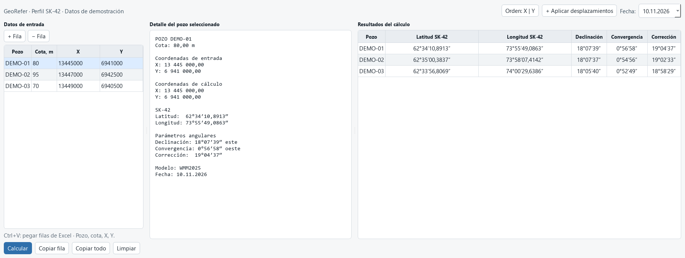

# GeoRefer — Transformación de coordenadas y correcciones angulares

Calculadora para preparar datos espaciales y correcciones angulares utilizados en trabajos con pozos. La versión actual utiliza un perfil SK-42 e integra la transformación de coordenadas, el cálculo de la convergencia de meridianos y la declinación magnética para una fecha seleccionada.

## Necesidad operativa

Las empresas y los contratistas pueden utilizar sistemas de coordenadas, proyecciones cartográficas y formatos de presentación diferentes. Al trabajar con pozos antiguos, se añaden documentos de distintas épocas, coordenadas abreviadas, desplazamientos locales y diferencias en la denominación de los ejes.

Para preparar estudios, intervenciones o la reanudación de trabajos en un pozo, es necesario conciliar los datos de origen y entregarlos en el formato requerido por el ejecutor. Las transformaciones manuales y la consulta de varias fuentes independientes consumen tiempo y aumentan el riesgo de errores de transcripción.

GeoRefer reúne estos cálculos en una misma interfaz para facilitar la preparación de información destinada a los equipos técnicos y a los contratistas.

## Datos de entrada

El usuario introduce o pega desde Excel una lista de pozos con su cota y sus coordenadas rectangulares.

Para el cálculo se establece el orden de los ejes, la aplicación de los desplazamientos locales configurados y la fecha de los parámetros magnéticos.

La versión actual utiliza un perfil de cálculo SK-42. La declinación magnética se obtiene mediante WMM2025 y su archivo de coeficientes.

## Funcionalidades

- Procesamiento de varios pozos mediante entrada tabular desde Excel.
- Intercambio de los ejes X/Y y aplicación de desplazamientos locales configurados.
- Conversión de coordenadas rectangulares SK-42 a coordenadas geográficas.
- Cálculo de la convergencia de meridianos.
- Cálculo de la declinación magnética para la fecha seleccionada dentro del periodo de validez de WMM2025.
- Obtención de la corrección angular resultante según la convención implementada: **D − γ**, donde D es la declinación magnética y γ la convergencia de meridianos.
- Avisos sobre coordenadas fuera del área prevista y posibles aplicaciones duplicadas de los desplazamientos.
- Vista detallada de los datos de entrada, las coordenadas calculadas y los parámetros angulares.
- Copia de resultados en un formato tabular compatible con Excel.

## Resultados y valor aportado

La herramienta reúne operaciones que habitualmente requieren varias consultas: revisar la forma de expresar las coordenadas, transformarlas y preparar las correcciones angulares.

El usuario obtiene resultados estructurados por pozo, junto con la fecha seleccionada y el nombre del modelo magnético. Esto agiliza la preparación de datos, reduce las tareas manuales repetitivas y facilita el intercambio de información con contratistas y equipos especializados.

Este enfoque resulta especialmente útil al trabajar con documentación de pozos antiguos que debe organizarse y conciliarse antes de su reutilización. Calcular parámetros para trabajos actuales y reconstruir las condiciones de mediciones históricas son tareas distintas: cada una requiere los modelos y los datos de origen adecuados.

La fiabilidad de la transformación depende de identificar correctamente el sistema de coordenadas, la proyección, el orden de los ejes y los desplazamientos locales. La calculadora facilita estas operaciones, pero no recupera información ausente sobre el origen de unas coordenadas de archivo.

## Posibilidades de desarrollo

La estructura modular permite adaptar el programa a otras necesidades mediante nuevos perfiles, proyecciones y parámetros de entrada.

Entre las posibles ampliaciones se encuentran la conversión inversa de coordenadas geográficas a rectangulares, la incorporación de otros sistemas de referencia y nuevas funciones para organizar documentación histórica.

Estas posibilidades se presentan como líneas de desarrollo, no como funciones ya implementadas. Cada nueva transformación requiere su propia configuración y comprobación.

## Mi contribución

Identifiqué la necesidad a partir de mi experiencia en la preparación de datos de pozos, desarrollé la calculadora e integré los cálculos de coordenadas y parámetros magnéticos en una misma interfaz, con intercambio tabular y comprobaciones de errores habituales de entrada.

## Demostración

La imagen muestra tres registros de demostración y los resultados calculados. Los datos no corresponden a un pozo de trabajo concreto.

El material público se limita a esta descripción y a la imagen de la interfaz. No se distribuyen el código fuente ni los datos de trabajo.

## Referencia del modelo magnético

[World Magnetic Model — NOAA/NCEI](https://www.ncei.noaa.gov/products/world-magnetic-model). WMM2025 es aplicable al periodo 2025–2029; no se utiliza aquí para reconstruir valores de hace veinte años.
